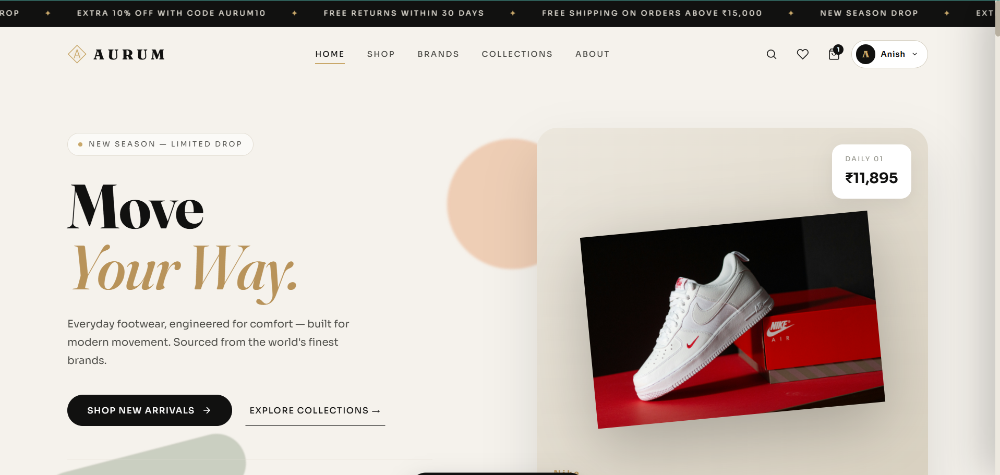
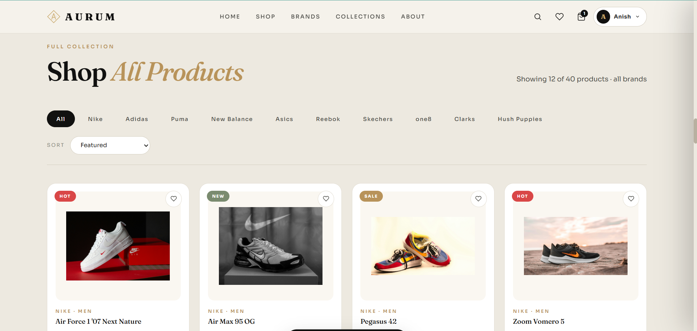
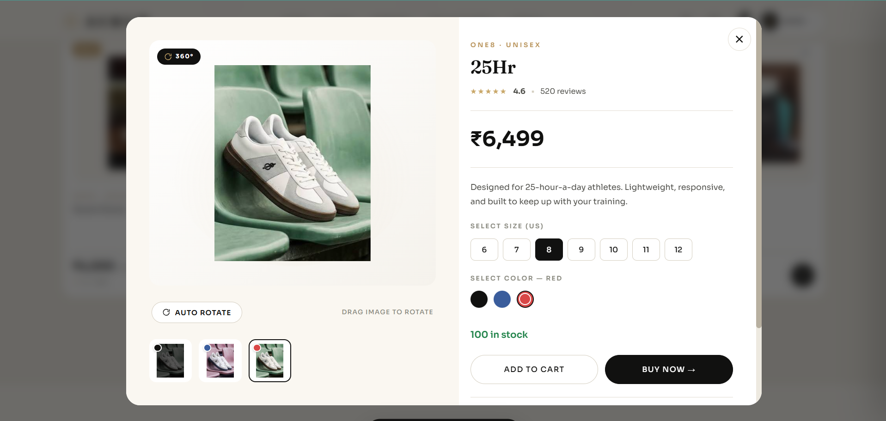
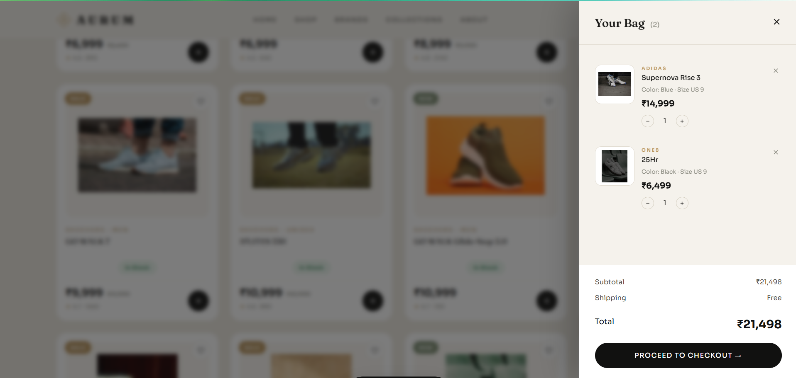
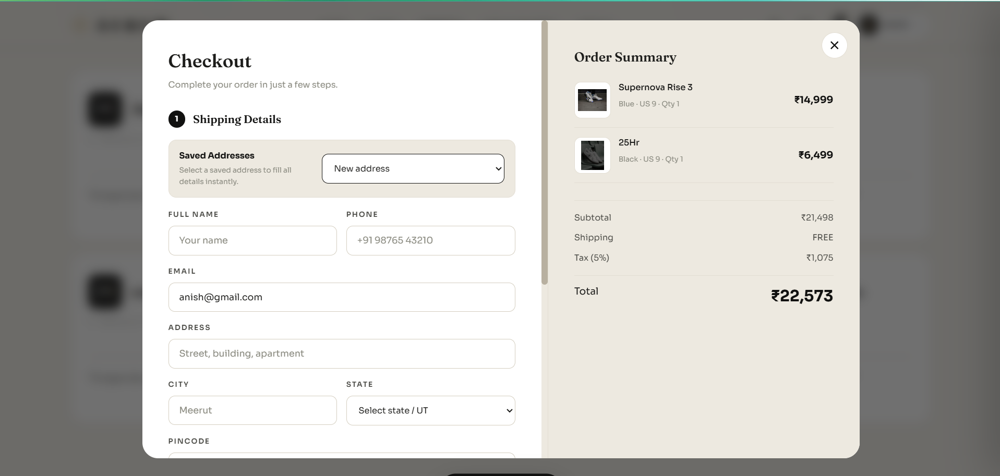
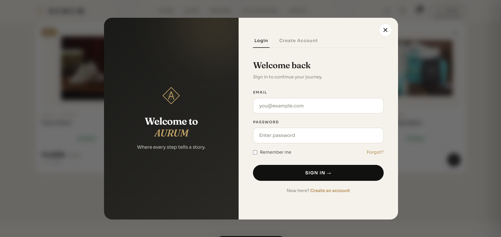
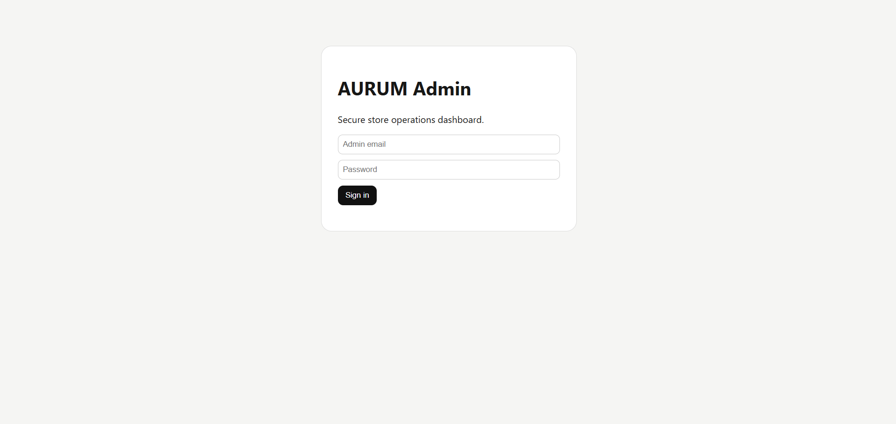
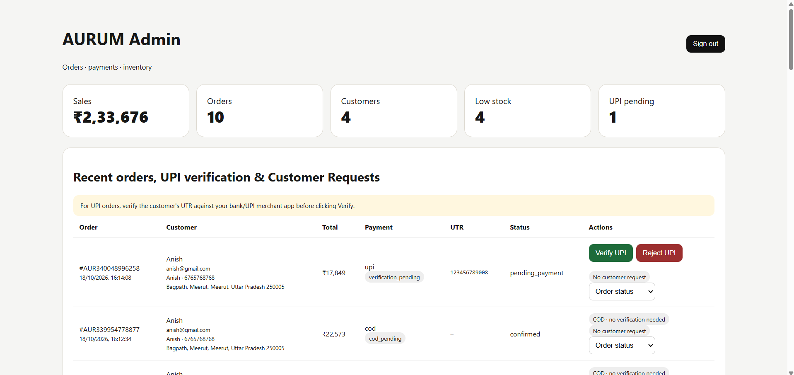

# 👟 AURUM Footwear — Premium Shoe Shopping Experience

<p align="center">
  <strong>A modern footwear e-commerce web application</strong>
  <br />
  Browse products, explore shoe details, manage your cart, and experience a dedicated store administration interface.
</p>

<p align="center">
  
</p>

<p align="center">
  
  
  
  
</p>

---

## 📌 About the Project

**AURUM Footwear** is a footwear e-commerce web application designed to provide a clean, modern, and convenient online shopping experience.

The project combines a customer-facing shopping interface with an administration area, bringing product discovery, shopping cart interactions, checkout, and store management together in one application.

The interface focuses on elegant presentation, intuitive navigation, product imagery, and a consistent visual experience.

## ✨ Key Features

### 🛍️ Customer Shopping Experience
- Modern footwear storefront and homepage.
- Product catalog with shoe imagery and pricing.
- Individual product details interface.
- Shopping cart interface.
- Checkout interface.
- Customer login interface.
- Responsive layout designed for different screen sizes.

### 🔐 Administration
- Dedicated admin login page.
- Admin dashboard interface.
- Store administration tools accessible through the admin area.

### ⚙️ Application & Backend
- Node.js and Express backend.
- SQLite database integration.
- Product data management.
- Environment-based application configuration.
- Separate frontend, backend, styles, and image assets.

> Feature availability may depend on the current implementation and configuration. Payment processing, order management, and authentication security should be verified before using the application in production.

---

## 🖥️ Screenshots

Explore the main interfaces of AURUM Footwear.

### 1. Homepage

The main storefront, featuring the AURUM brand and shopping experience.


### 2. Product Catalog

Browse the available footwear collection.



### 3. Product Details

Explore an individual product's details, pricing, and available selection options.



### 4. Shopping Cart

Review selected products and the cart summary.



### 5. Checkout

View the checkout interface and order summary.



### 6. Customer Login

The customer sign-in interface.



### 7. Admin Login

The dedicated entry point for store administration.



### 8. Admin Dashboard

The administration dashboard for the store.



---

## 🧰 Tech Stack

| Technology | Purpose |
|---|---|
| HTML5 | Page structure |
| CSS3 | Styling and responsive layouts |
| JavaScript | Client-side interactions |
| Node.js | Server-side runtime |
| Express.js | Backend web framework |
| SQLite | Local database |
| npm | Dependency management |
| Git & GitHub | Version control and project hosting |

---

## 📁 Project Structure

```text
Aurum-Footwear/
│
├── admin/                  # Admin interface
├── css/                    # Stylesheets
├── images/                 # Product and website images
├── js/                     # Frontend JavaScript
├── screenshots/            # README screenshots
│   ├── 01-homepage.png
│   ├── 02-products.png
│   ├── 03-product-details.png
│   ├── 04-cart.png
│   ├── 05-checkout.png
│   ├── 06-login.png
│   ├── 07-admin-login.png
│   └── 08-admin-dashboard.png
│
├── server/
│   ├── index.js             # Backend entry point
│   └── products.json        # Product data
│
├── .env.example             # Example environment configuration
├── .gitignore
├── index.html               # Main storefront
├── package.json
├── package-lock.json
└── README.md
```

*Note: The structure above highlights the main project files. Additional files may exist in your local project.*

---

## 🚀 Getting Started

Follow these steps to run AURUM Footwear locally.

### Prerequisites

Make sure you have installed:

- [Node.js](https://nodejs.org/)
- npm (included with Node.js)
- [Git](https://git-scm.com/) — optional, for cloning the repository
- Visual Studio Code or another code editor

### 1. Clone the Repository

Replace `YOUR-USERNAME` with your GitHub username after uploading the project.

```bash
git clone https://github.com/YOUR-USERNAME/Aurum-Footwear.git
cd Aurum-Footwear
```

Alternatively, download the repository ZIP and extract it.

### 2. Install Dependencies

Open a terminal in the project directory and run:

```bash
npm install
```

### 3. Configure Environment Variables

Create a local `.env` file in the project root, using `.env.example` as a reference.

Example:

```env
PORT=3000
NODE_ENV=development
JWT_SECRET=replace-with-a-long-random-secret
UPI_ID=your-upi-id@example
UPI_NAME=Your Store Name
ADMIN_EMAIL=admin@example.com
ADMIN_PASSWORD=replace-with-a-strong-password
```

Use the exact variable names expected by your application. Generate a strong, unique secret and set secure administrator credentials. Never publish your actual `.env` file.

### 4. Start the Application

```bash
npm start
```

If the server starts successfully, open:

**Storefront:** http://localhost:3000

**Admin Area:** http://localhost:3000/admin/

The exact available routes depend on the current application configuration.

---

## 🔒 Security Notes

- Never commit `.env` or any file containing private credentials.
- Keep `node_modules/` and local database files out of Git.
- Use strong, unique administrator credentials.
- Generate a secure random JWT secret for local or production configuration.
- Validate user input on the server.
- Protect administrative endpoints with server-side authentication and authorization.
- Do not treat a displayed payment option or UPI identifier as proof of successful payment.
- Use HTTPS and review the application's security configuration before production deployment.

---

## 🧪 Testing Checklist

Before publishing a release, verify the following in your local environment:

- [ ] The homepage loads correctly.
- [ ] Product images and prices display correctly.
- [ ] Product details open as expected.
- [ ] Adding and reviewing cart items works.
- [ ] The checkout flow behaves as intended.
- [ ] Customer login works, if authentication is implemented.
- [ ] Admin login and protected routes work correctly.
- [ ] The application handles missing or invalid input.
- [ ] The layout works on desktop and mobile screens.
- [ ] No private credentials or database files are included in the GitHub repository.

---

## 🛣️ Future Improvements

Potential enhancements for future versions include:

- Product search, filtering, and sorting.
- Product categories, sizes, and stock management.
- Customer registration and account management.
- Persistent cart and order history.
- Secure payment gateway integration.
- Order status tracking.
- Product reviews and ratings.
- Improved accessibility and responsive design.
- Automated tests and production deployment.

---

## 👨‍💻 Author

**Saurav Kumar**

BCA Student | Aspiring Software Developer

Interested in web development, backend engineering, and building practical software projects.

- GitHub: [saurav-kumar-tech](https://github.com/saurav-kumar-tech)

---

## 📄 License

No license has been specified yet. Add a `LICENSE` file if you want to publish the project under a particular open-source license.

---

<p align="center">
  <strong>AURUM Footwear</strong>
  <br />
  Crafted for a modern footwear shopping experience.
</p>
